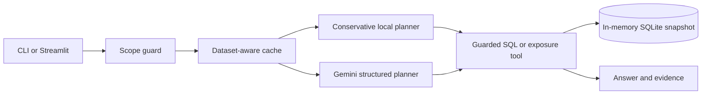

# Portfolio Intelligence

Ask a question about the supplied portfolio snapshot. Get a grounded answer, then inspect the calculation and source rows.

This is an independent implementation of PL Capital's AI Engineering exercise. The **command-line agent and evaluator** are the core deliverables; the Streamlit desk is an optional interface over the same code. The sample contains **13 portfolios, 95 holdings, 30 securities, and 9 linked tables**.


[Quick start](#quick-start) · [Examples](#try-it) · [Verification](#verify-the-project) · [Calculation guide](docs/CALCULATIONS.md) · [Original brief](assessment/README.md)

## Quick start

Use **64-bit Python 3.11–3.13**. No database server, Docker, Node.js, or manual CSV import is required.

### 1. Get the project

Clone the private repository:

```powershell
git clone https://github.com/jeelsoni01/pl-capital-portfolio-agent.git
cd pl-capital-portfolio-agent
```

For a GitHub ZIP download, extract it and open a terminal in the folder that contains `setup_project.py`.

### 2. Install

```powershell
python setup_project.py
```

Setup creates `.venv`, installs the pinned dependencies, checks them, and creates `.env` without overwriting an existing key. The supplied examples and tests run **without an API key**. To enable Gemini planning for other in-scope questions, set `GEMINI_API_KEY` in your local `.env`; the default model is `gemini-3.5-flash-lite`. The key file is Git ignored. On macOS/Linux, use `python3 setup_project.py`.

### 3. Run

Required CLI on Windows:

```powershell
.\.venv\Scripts\python.exe -m portfolio_agent
```

At `Ask>`, enter `How many portfolios do we have in total?` — expected answer: **13**. Type `exit` to quit. You can also pass a question directly:

```powershell
.\.venv\Scripts\python.exe -m portfolio_agent "What is the total AUM for portfolios with high target risk level?"
```

Optional Streamlit desk:

```powershell
.\.venv\Scripts\python.exe -m streamlit run app.py
```

Open `http://127.0.0.1:8501`. On macOS/Linux, replace `.\.venv\Scripts\python.exe` with `./.venv/bin/python`.

## Try it

| Question | What it demonstrates |
| --- | --- |
| How many portfolios do we have in total? | Read-only SQL aggregate |
| What are the names of all active portfolios? | Filtering by recorded status |
| What are the sector exposures for the Tech Innovation Fund? | Deterministic stock-weight calculator |
| Which active high-risk portfolio has the highest Technology exposure? | SQL cohort selection plus exposure calculation |
| What is the total AUM for portfolios with high target risk level? | Filtered sum of recorded AUM |

Add `--json` to a direct CLI question for machine-readable rows, warnings, route, and evidence. Each question is independent; state the portfolio, metric, and filters you need. The desk also provides a portfolio explorer and CSV export.

## Verify the project

After setup, run:

```powershell
.\.venv\Scripts\python.exe -m pip check
.\.venv\Scripts\python.exe -m pytest -q
.\.venv\Scripts\python.exe evaluate.py --output reports\local-evaluation.json
.\.venv\Scripts\python.exe evaluate.py --cases tests\additional_questions.json --output reports\additional-local.json
```

These checks need no key. The cleaned repository passes **10/10 supplied questions**, **9/9 additional development questions**, and **168 automated tests**. The [validation record](VALIDATION.md) and [retained reports](reports/README.md) distinguish local calculations from live model planning. GitHub Actions repeats setup, tests, and both local evaluations across Windows and Ubuntu with Python 3.11, 3.12, and 3.13.

To test the Gemini route after setting a key:

```powershell
.\.venv\Scripts\python.exe diagnose_gemini.py
.\.venv\Scripts\python.exe evaluate.py --gemini-only --output reports\gemini-check.json
```

`--gemini-only` bypasses the fast local planner and consumes API quota. The last complete retained model run passed **10/10 supplied questions**; this is a development-set result, not a promise for arbitrary unseen questions. Provider timeouts are reported as unavailable, not converted into invented answers. The evaluator independently checks reference SQL and sector calculations, including ranked order.

## Design and scope



| Exercise requirement | Delivered here |
| --- | --- |
| Natural-language SQL tool | Structured question plan, validated read-only SQL, bounded results |
| Sector exposure tool | Deterministic stock-weight grouping with bond exclusion |
| Command-line agent | `python -m portfolio_agent`, interactive or single-question mode |
| Ground-truth evaluator | `evaluate.py`, independent reference checks and per-case reports |

The local planner handles clearly recognized question shapes without a model call. Other in-scope questions use Gemini to propose a validated SQL, exposure, or combined plan. Python and SQLite calculate the numbers; the model does not supply them. Queries are read only, parameterized where locally planned, restricted to supplied tables/functions, and bounded by row, length, and execution limits. An unrelated request or investment-advice request receives scope guidance.

Exposure sums supplied `current_weight` for stocks by sector and excludes bonds. The default percentage uses the whole portfolio; an explicit equity basis divides by total stock weight. Recorded AUM comes from `portfolios.total_aum`, not quantity × price. See the [calculation guide](docs/CALCULATIONS.md) for the exact conventions. This small structured dataset uses SQL rather than RAG or GraphRAG.

The answer cache stores only successful answers, with keys tied to the data, schema, code, model, and question. No explicit Gemini prompt cache is configured. The default Streamlit server binds to `127.0.0.1`.

## Repository

| Path | Purpose |
| --- | --- |
| `portfolio_agent/` | Agent, planners, guarded database, exposure tool, cache, presentation |
| `app.py` | Optional Streamlit desk |
| `evaluate.py` | Ground-truth evaluator |
| `setup_project.py`, `requirements-lock.txt` | Reproducible Python setup |
| `start.ps1`, `diagnose_gemini.py` | Windows UI launcher and provider diagnostic |
| `benchmark.py` | Optional local and warm-cache latency measurement |
| `tests/`, `.github/workflows/verify.yml` | Regression and clean-install checks |
| `reports/`, `VALIDATION.md` | Retained results and their limits |
| `data/`, `assessment/`, `database_schema.sql`, `ground_truth_dataset.json` | Original supplied materials |
| `docs/` | GitHub demo GIF and calculation guide |

## Troubleshooting

| Symptom | Action |
| --- | --- |
| Python is missing or too old | Install 64-bit Python 3.11–3.13 and reopen the terminal. |
| A module is missing | Rerun `python setup_project.py` and use the `.venv` Python shown above. |
| Gemini key is missing or rejected | Check your local `.env` and run `diagnose_gemini.py`. Local routes still work. |
| Gemini is slow or unavailable | Retry later; provider latency varies. No guessed answer is substituted. |
| Port 8501 is occupied | Use the existing desk or start with `--server.port 8502`. |
| A question is ambiguous | State the portfolio, metric, period, and filters explicitly. |

## Provenance and license

Created by **Jeel Soni** for the PL Capital AI Engineering exercise. The app is independent and is neither an official PL Capital service nor investment advice. Original code and documentation are [MIT licensed](LICENSE). The supplied assessment files and company mark have separate ownership and are excluded; see [third-party notices](THIRD_PARTY_NOTICES.md). The fixed dataset is historical sample data, not a live market feed.
