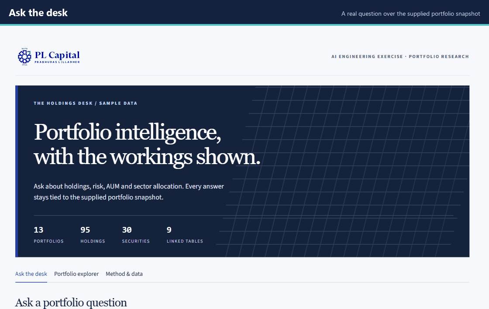
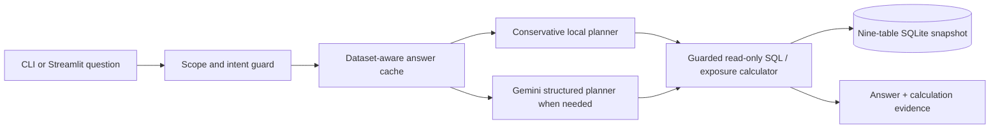

# Portfolio Intelligence for PL Capital

**An independent AI Engineering exercise:** ask questions about the supplied portfolio snapshot and inspect the calculation behind each answer. The required deliverable is a Python CLI; the Streamlit desk is an optional, custom interface over the same agent.

**13 portfolios · 95 holdings · 30 securities · 9 linked tables** in the provided sample data. This is not an official PL Capital service or live market feed.



*The GIF shows real local Streamlit results. [See how it was captured and rebuilt](docs/demo/README.md).*

**Jump to:** [Run it](#run-it) · [How it works](#how-it-works) · [Verify it](#verify-it) · [Safety and limits](#safety-and-limits) · [Project map](#project-map)

## Run it

Use Python **3.11–3.13**. On Windows PowerShell, from a checkout of this private repository:

```powershell
git clone https://github.com/jeelsoni01/pl-capital-portfolio-agent.git
cd pl-capital-portfolio-agent
python setup_project.py
.\.venv\Scripts\python.exe -m jeel_portfolio "What is the total AUM for portfolios with high target risk level?"
.\.venv\Scripts\python.exe -m streamlit run app.py
```

The last command opens the optional interface at `http://127.0.0.1:8501`. For macOS/Linux, run `python3 setup_project.py` and use `./.venv/bin/python` in place of `.\.venv\Scripts\python.exe`.

**No API key is needed** for the supplied ten questions, common local question patterns, the tests, or the demo. For a question that needs model planning, set `GEMINI_API_KEY` in the local `.env` created by setup. The default model is `gemini-3.5-flash-lite`; `.env` is Git ignored. [Check the provider connection](#verify-it) before relying on live model questions.

The CLI also accepts an interactive session (`.\.venv\Scripts\python.exe -m jeel_portfolio`) and JSON output (`--json "your question"`). Try the AUM question above: the sample snapshot yields **85,000,000 in recorded AUM for high target risk portfolios**. The dataset does not specify a currency, so the app does not invent one.

## How it works



The local planner handles recognized question shapes without a network call. It builds parameterized SQL and uses a separate stock-sector exposure calculator for allocation questions. Unrecognized but in-scope questions go to Gemini for a structured plan; that plan must pass validation before tools run. A hybrid plan can choose a portfolio cohort in SQL and then calculate sector exposure for each selected fund. The answer cache stores only successful results and invalidates them when the data, schema, implementation, or model changes.

Sector exposure uses the supplied `current_weight` of **stocks** in each sector. Its default denominator is the **whole portfolio**; an explicit equity basis renormalizes across stock weights. Bonds are excluded from sector numerators. The interface explains this next to results and allows the reviewer to inspect the holdings, query, parameters, and calculation route.

This small structured dataset needs exact joins and arithmetic. It does not use RAG or GraphRAG. An unrelated question, request for personal information, or investment advice receives scope guidance without a model call.

## Verify it

```powershell
.\.venv\Scripts\python.exe -m pip check
.\.venv\Scripts\python.exe -m pytest -q
.\.venv\Scripts\python.exe evaluate.py --output reports\evaluation-current.json
.\.venv\Scripts\python.exe evaluate.py --cases tests\shardul_extra_questions.json --output reports\shardul-extra-local.json
.\.venv\Scripts\python.exe evaluate.py --cases tests\holdout_questions.json --output reports\holdout-local-new.json
```

To test the **model route itself** after adding a key, run:

```powershell
.\.venv\Scripts\python.exe diagnose_gemini.py
.\.venv\Scripts\python.exe evaluate.py --gemini-only --output reports\gemini-evaluation.json
```

| Check | Recorded result | What it measures |
| --- | ---: | --- |
| Supplied ten questions, local route | **10/10**, 2.02 ms median | Exact local SQL/exposure path |
| Supplied ten questions, Gemini-only route | **10/10**, 2.68 s median | Live model planning, with API/network time |
| Shardul's eight published extra questions | **8/8** local | Additional known question shapes |
| Nine other development questions | **9/9** local | Additional known question shapes |
| Automated tests | **168 passing** | Routing, calculations, guardrails, UI, and setup behavior |
| Last completed fresh-install CI run | **6/6 jobs** | Windows and Ubuntu × Python 3.11, 3.12, 3.13 |

The recorded results are in [`reports/`](reports/README.md); CI reruns the local sets on each push in [`.github/workflows/verify.yml`](.github/workflows/verify.yml). The evaluator executes reference SQL and calculates expected exposures independently. Local scores **do not** measure Gemini accuracy; `--gemini-only` bypasses local planning. All named question sets were visible during development, so these scores do not guarantee answers to arbitrary unseen questions. Times are in-process measurements on this machine, excluding Python startup and Streamlit rendering. New Gemini requests depend on network and provider latency. Earlier provider timeouts are retained in the reports and are not counted as failed accuracy cases.

## Safety and limits

- The SQLite connection is read only and authorizes only supplied tables and restricted functions. Queries have a **500-row cap**, SQL length cap, and **2-second / 2-million-step** work budget. Model output cannot modify data.
- Local plans use bound parameters. A Gemini plan is validated before SQL or exposure tools run; one SQL repair is allowed. A provider outage produces an explicit error, never a fabricated number.
- The Streamlit server binds to `127.0.0.1` by default. API keys stay in the Git-ignored `.env`; the repository contains `.env.example` instead.
- This is a **fixed historical exercise snapshot**. `current_price` is the supplied price, not a live quote. Holding and price timestamps are not provided, and no currency is specified for AUM.
- Cached answers are local to `.cache/answers.sqlite3` and are keyed to the dataset and code. Explicit Gemini prompt/context caching is not configured.

## Project map

| Path | Purpose |
| --- | --- |
| [`jeel_portfolio/`](jeel_portfolio/) | Agent, local and Gemini planners, SQL guard, exposure calculator, cache, presentation |
| [`app.py`](app.py) | Optional Streamlit desk and portfolio explorer |
| [`evaluate.py`](evaluate.py) | Independent reference evaluation and latency report |
| [`setup_project.py`](setup_project.py), [`requirements-lock.txt`](requirements-lock.txt) | Reproducible Python environment |
| [`data/`](data/), [`database_schema.sql`](database_schema.sql) | Original supplied snapshot and schema |
| [`tests/`](tests/) | Automated checks and attributed comparison questions |
| [`docs/demo.gif`](docs/demo.gif) | Real-interface README walkthrough |

The supplied assessment material and PL Capital mark remain their owners' property. The borrowed comparison questions and their license are identified in [`THIRD_PARTY_NOTICES.md`](THIRD_PARTY_NOTICES.md).
