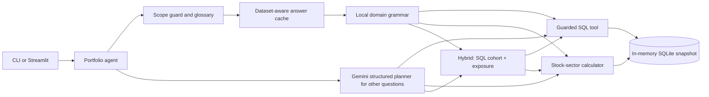

# Jeel's Portfolio Agent

An independent implementation of PL Capital's AI Engineering exercise. It answers questions over the supplied portfolio snapshot using a guarded SQL tool, a deterministic stock-sector exposure calculator, or both together for filtered comparisons. The CLI is the required deliverable; Streamlit is an optional view over the same agent.

## Reproduce from a GitHub checkout

Install Python 3.11 or newer, clone this repository, open a terminal in its root, and run:

```powershell
python setup_project.py
.\.venv\Scripts\python.exe -m pip check
.\.venv\Scripts\python.exe -m pytest -q
.\.venv\Scripts\python.exe evaluate.py
.\.venv\Scripts\python.exe evaluate.py --cases tests\shardul_extra_questions.json
.\.venv\Scripts\python.exe -m jeel_portfolio
```

`setup_project.py` creates `.venv`, installs `requirements-lock.txt`, and creates an empty `.env` only if one does not exist. On macOS/Linux, use `python3 setup_project.py` and replace `.\.venv\Scripts\python.exe` with `./.venv/bin/python`. The supplied ten questions and common local routes work without an API key. To use Gemini for other questions, put `GEMINI_API_KEY` in your local `.env`; never commit it. [GitHub Actions verified fresh installs](https://github.com/jeelsoni01/pl-capital-portfolio-agent/actions/runs/42494568473) on Windows and Ubuntu with Python 3.11, 3.12, and 3.13: all six jobs passed their dependency check, 167 tests, and three local question sets. A separate local Python 3.12 download attempt timed out; the CI job completed that clean install successfully.

Ask one question directly on Windows:

```powershell
.\.venv\Scripts\python.exe -m jeel_portfolio "Which portfolio has the largest total AUM?"
.\.venv\Scripts\python.exe -m jeel_portfolio --json "What are the sector exposures for the Balanced Portfolio?"
```

Optional interface:

```powershell
.\.venv\Scripts\python.exe -m streamlit run app.py
```

The Streamlit desk uses PL Capital's complete four-part mark and a custom research layout. Answers now lead with the requested fund and figure in bold, followed by a plain-language calculation basis. A ranked exposure question shows every compared portfolio on labelled 0–100% bars; a one-result chart is omitted. Calculation route, timing and SQL remain in the evidence expander. Results can be downloaded, and the portfolio explorer shows holdings behind an allocation. The interface is an independent assessment demo, not an official PL Capital service. Its default server address is `127.0.0.1`, so the unauthenticated demo is available only on the local computer.

The company logo asset was taken from the locally available Holdings Desk reference project. It is used only to identify the assessment context; all application UI and agent code here are separate. PL Capital owns its mark.

## Architecture



The local grammar handles clearly recognized patterns with parameterized SQL and no model call, including bounded creation-date filters for total AUM. It contains no hardcoded answer values: every result comes from the supplied data. A question with extra filters the grammar cannot represent goes to Gemini instead of dropping the filters. A small local glossary answers exact term-definition questions such as “What is portfolio?” without Gemini. Clearly unrelated requests, personal-identity questions, investment advice, and instruction-changing requests receive immediate scope guidance without a model call. Gemini plans other questions into a validated `sql`, `exposure`, `hybrid`, or `clarify` action. The hybrid action selects a portfolio cohort using SQL, then applies the same exposure calculator to each fund. One SQL repair is allowed. The app does **not** use RAG or GraphRAG because the nine small structured tables fit in memory and require exact arithmetic rather than document retrieval.

The additional common-question planner covers parameterized portfolio/asset counts, AUM thresholds and rankings, latest performance dates, missing performance records, combined holding weights, and several recorded-weight sector exposure phrasings. Every pattern must match the complete question; unsupported modifiers go to Gemini. This widens fast coverage without treating a known evaluation question as a hardcoded answer.

The SQL connection is read only and authorizes only reads of supplied tables and a restricted set of functions. Queries have a 2-second/2-million-step work budget, SQL length cap, and 500-row result cap. Model output cannot update data. The exposure calculator uses recorded `current_weight`, groups stocks by sector, and excludes bonds. Its default denominator is the whole portfolio. An explicit equity basis divides by the total stock weight. Incomplete weight totals are flagged, not silently treated as cash. No live price feed is connected.

The persistent **answer cache** sits in `.cache/answers.sqlite3` (Git ignored). Cache keys include a hash of every supplied CSV, the schema, the implementation, the model name, and the question. It caches only successful answers. Restarted processes can reuse answers while data, model, or code changes invalidate them. The interactive CLI and Streamlit reuse one in-process agent. Explicit Gemini **prompt/context caching** is not configured; Google's implicit caching is provider-managed and is not counted as an application cache hit. The compact schema prompt does not justify adding a paid, expiring explicit cache without a measured benefit.

Gemini uses the same `gemini-3.5-flash-lite` model as the two reviewed submissions. The planner sends a compact schema, uses minimal thinking for simple questions, low for multi-step questions, and medium for complex market-value breakdowns. It reuses its HTTP client and retries a dropped connection once. `GEMINI_TIMEOUT_SECONDS` defaults to 60 seconds and can be set from 5 to 120. If a request reaches that wall limit, a late result can be reused when the same question is retried in the same process. A network outage returns an explicit provider error; it never substitutes a fabricated calculation. The local grammar and cached answers continue to work without Gemini.

## Check the work

```powershell
.\.venv\Scripts\python.exe -m pytest -q
.\.venv\Scripts\python.exe evaluate.py --output reports\evaluation.json
.\.venv\Scripts\python.exe evaluate.py --gemini-only --output reports\gemini-evaluation.json
.\.venv\Scripts\python.exe evaluate.py --gemini-only --cases tests\holdout_questions.json --output reports\holdout-gemini.json
.\.venv\Scripts\python.exe diagnose_gemini.py
.\.venv\Scripts\python.exe benchmark.py
```

The evaluator runs each reference SQL independently, computes expected exposures separately from CSVs, checks numeric results and tool selection, and preserves ranking order for the top-holdings case. Its default hybrid mode exercises the local grammar, so its score is **not** evidence of Gemini accuracy. `--gemini-only` bypasses the grammar and uses API quota. A live unseen question is also needed to assess generalization. Reports retain route and per-case time.

The current local evaluation passes **10/10** with about a **1.8 ms median in-process answer time** on this machine. Shardul's eight published extra questions pass **8/8** through local plans, and nine other development questions pass **9/9** locally. The expanded suite passes **167 tests** under both Python 3.12 and 3.13. The current full Gemini-only run passed **10/10**, with **2.68 seconds median**. An earlier attempt was interrupted by a provider timeout after two passes; a separate Gemini-only run of Shardul's extra set was interrupted on its first request. Those interrupted runs are not accuracy scores. A warm in-process cache hit previously measured **8.4 microseconds median** over 5,000 standalone repetitions. These measurements exclude Python startup, Streamlit rendering, and network variation. New Gemini requests cannot honestly be promised at microsecond latency. All named question sets were visible during development; none is a blind guarantee for arbitrary future questions. The retained reports in `reports/` distinguish local and Gemini-only runs.

## Files

| Path | Role |
|---|---|
| `jeel_portfolio/database.py` | Load and validate the original snapshot; execute guarded SQL |
| `jeel_portfolio/exposure.py` | Exact stock-sector weight calculation |
| `jeel_portfolio/planner.py` | Gemini structured planning |
| `jeel_portfolio/common_questions.py` | Conservative parameterized plans for common question shapes |
| `jeel_portfolio/presentation.py` | Clear factual result summaries |
| `jeel_portfolio/agent.py` | Routing, tool use, safe results, caching |
| `jeel_portfolio/cache.py` | Memory and disk answer cache |
| `evaluate.py` | Ground-truth evaluation |
| `app.py` | Optional Streamlit interface |
| `assets/pl-capital.svg`, `.streamlit/config.toml` | PL Capital mark and interface theme |
| `data/`, `database_schema.sql`, `ground_truth_dataset.json` | Original assessment data |
| `brief/` | Original README and suggested dependencies |
| `tests/shardul_extra_questions.json` | Attributed comparison set included for reproduction |
| `.github/workflows/verify.yml` | Fresh setup, tests, and local evaluation on Windows and Ubuntu |

## Limits

The dataset is a fixed exercise snapshot; `current_price` is only the price in that snapshot. Gemini can make mistakes on new questions. Successful responses show the SQL and parameters or the exposure formula so a reviewer can inspect them. Failures return an error rather than a fabricated value. The provided evaluation set is known during development and is not a blind benchmark.
